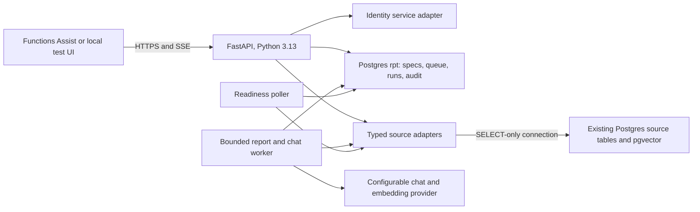
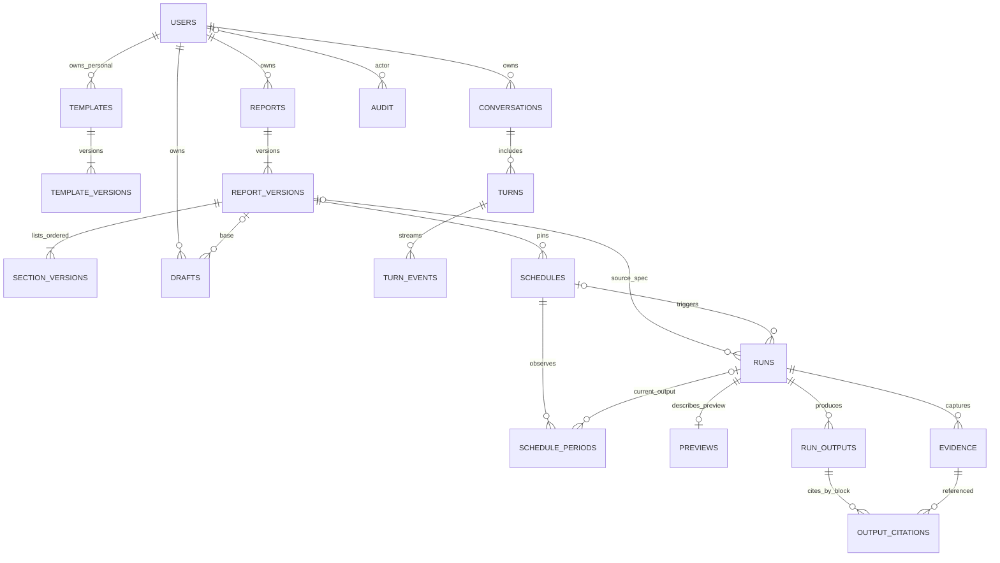

# Phase 0 architecture plan

## Product and first release

An analyst builds a versioned report one section at a time, previews the output and its source evidence, and explicitly saves the specification. A quarterly schedule reruns the saved version when its required inputs are ready. The same spec works through chat, the structured editor, and the worker. Every amount has an evidence trail, and every missing input has a visible explanation.

The first end-to-end slice is an earnings brief with a structured KPI trend and a management themes section. It exercises the hardest boundaries early: deterministic numbers, legacy and unified earnings coverage, draft-to-saved isolation, citations, and quarter roll-forward. The other adapters expose the same retrieval contract. Reports and personal templates start owner-only. System templates are readable by authenticated users. Email delivery and collaborative editing are deferred pending product direction.

## Architecture and process boundaries



Use one Python codebase with API and worker processes. The API handles auth, validation, draft edits and durable job submission. Background processes claim persisted jobs, run work with explicit bounds, and write progress and final output. Start with a Postgres-backed queue and a poller process. This keeps jobs durable without adding infrastructure to the first release. Use separate connection pools and credentials for the read-only upstream database and the `rpt` database, even when local development hosts both in one cluster. Provision the local source fixture as a separate bootstrap action.

## Data model



The [draft DDL](rpt-draft.sql) defines resource relationships and constraints for review. Report and section versions are immutable. Section IDs survive edits and reordering. A section version stores one typed JSON pipeline with stable stage IDs and the report's spec format version. Template versions hold reusable specs. Copying a template resolves its version at instantiation and records origin metadata. Runs pin the full spec, resolved scope, source revision manifest and engine version. Run evidence uses stable document references and content hashes, with a minimal validation snapshot where retention allows. Audit records store event codes and internal IDs.

In G1, route all lookups through owner-scoped repository methods. Resolve nested resources through their authorized parent in the same transaction, including baselines, SSE cursors, downloads, previews and cancellation. A save locks the report, validates owner and base version, inserts the version plus all sections in one transaction and returns the new ETag. A concurrent stale save receives a conflict with the latest version. Mutation idempotency records are committed with the update, scoped to the verified actor and operation, and bind the key to a payload digest. Draft and schedule changes use their own optimistic version checks. A schedule stays pinned to the chosen saved version until an explicit update.

## Source adapters and evidence

Expose typed methods `probe(scope)`, `search(request)` and `fetch_anchors(refs)`. Return bank, original and normalized period, revision or content hash, source role, data and safe citation anchors. The module that handles a source owns its query templates, version selection and normalization. Queries bind values and use a static, allowlisted map of qualified relation names. Adapters apply bounded bank and period predicates before ranking, with query timeouts and result caps.

| Logical source | Read strategy | Evidence anchor |
|---|---|---|
| Benchmarking | Resolve metric name and allowed metric/segment pairs with `kpi_metadata` plus actual pair discovery. Keep NULL observations distinct from absent rows. Use exact decimals and treat unit, currency and BPS semantics as separate fields. Explicit aggregate namespace for rows with NULL bank symbol. | Snapshot identity plus original bank/metric/platform/period. Add page and sheet when a verified upstream crosswalk exists. Label the dataset as derived otherwise. |
| Investor slides | Unified tables, filter by bank/year/quarter. Join file and content IDs with the documented fallback. Expand section summary IDs within the same file. Combine text, tag and compatible vector results. | Safe document reference and page number. |
| Financial supplements | Unified pair, match both raw bank forms and normalize after lookup. Expand sibling sheet chunks within the file and sort part numbers numerically. Distinguish alternate spellings from alternate document editions. | Safe document reference and sheet index/name, plus cells when validated. |
| Earnings calls | Read legacy and unified behind one adapter. Preserve source reading order. Pick the document version first (Corrected over Raw, then verified tie-break), then keep all of its blocks. Merge cross-generation records only using a verified event mapping; surface unresolved overlap to the caller. | Title, permitted document reference, section and available block/group coordinates. |
| Events | Legacy first. Keep earnings and non-earnings catalogs separate. Enable unified events only after verifying content type and bank keys. | Event title, company and block/group where supported. |
| Pillar 3 | Legacy initially. Test template-code match per bank, then bounded text and vector search. Unified twin gated on anchor and coverage parity. | Filename and sheet. |
| RTS | Legacy initially. Search breadcrumbs and validated table cells first. Treat propositions as candidates and check against the original text. Unified twin gated on parity. | Filename and PDF page. |

Maintain a dynamic instrument catalog from availability and observed keys, with reviewed aliases and a distinct aggregate namespace. Resolve an ambiguous short symbol before querying. Preserve both fiscal label and alignment basis. The Canadian calendar spans November through October. A mixed-bank calendar-aligned comparison requires approved period-end mappings. Otherwise an explicitly requested vendor-label comparison shows its basis. Within each request, translate the normalized fiscal year/quarter into the relation's field names and parameter types. Compare conflicting source period fields and surface discrepancies.

Use availability flags to populate the picker and prioritize probes. The physical tables decide readiness for requested source/bank/period tuples, even for an unflagged period. A probe distinguishes ready, incomplete, absent and unknown/query unavailable. A NULL KPI observation is incomplete for a required metric. The adapter evaluates completeness at the requested granularity. No production paths depend on briefing counts, hard-coded coverage intervals or synthetic symbols.

Support parameterized cosine search against the actual type, with `vector(3072)` or `halfvec(3072)` casts and known-compatible model IDs. Calibrate separate thresholds and caps per source on judged samples. When a vector fails compatibility or relevance, return bounded text results or insufficient evidence. Release-gate degraded behavior on missing permissions, partial refresh and unsupported keys.

For re-ingestion compute an ordered hash of each relevant partition's stable document IDs and revisions, or a digest of scoped row natural keys and normalized values when revisions are unavailable. Treat changes in evidence-bearing content as new revisions and ignore ephemeral row IDs and churn-only load timestamps. Where source size makes full hashing expensive, the reviewer must confirm a trustworthy change marker or allow a bounded incremental scan with periodic reconciliation. Use a short read-only repeatable-read snapshot to collect a finite evidence set where the upstream supports it, then close the transaction before LLM calls. Recheck manifest on snapshot creation and before a scheduled result becomes current. Treat vanished or mismatched anchors as stale and preserve prior outputs with their revision metadata.

## Report specification and execution

The report spec includes title, ordered sections, default banks and fiscal calendar policy, semantic schema version and rendering preferences. Each section can override bank and time scope, set input requirements, and list ordered stages with typed inputs, named outputs and per-stage limits. An initial pipeline is a bounded sequence. Each input links to an earlier stage or a declared input, which permits branching data flow and fan-in with deterministic ordering.

```yaml
spec_version: 1
title: Earnings brief
sections:
  - id: performance
    time: {anchor: run_quarter, offsets: [0, -1, -4], basis: fiscal_label}
    sources:
      - {key: kpis, source: benchmarking, required: true}
    stages:
      - {id: facts, kind: retrieve, source: kpis, metric: Net Income, platform: Enterprise}
      - {id: trend, kind: calculate, inputs: [facts], operation: comparable_changes}
      - {id: table, kind: format, inputs: [trend], layout: trend_table}
```

Time selectors use a normalized quarter ordinal. Recognize a specific fixed quarter, run quarter, explicit offsets, trailing window with bounded length, or a bounded walk by quarter/year. Diff/time comparisons name the current and baseline positions, with missing period labels preserved. Use fiscal-label arithmetic for named vendor periods. Calendar maturity and calendar alignment use approved bank calendar metadata. Validate allowed combinations and cap the expansion before job submission. Report and stages share a typed policy for optional and required scopes. Stage ordering is canonical, even when I/O can be done concurrently.

| Stage | Input and outcome |
|---|---|
| `retrieve` | Typed filters and scope to evidence records. An advanced one-step narrative or table stage compiles into a bounded internal retrieve/validate/format path. |
| `extract` | Evidence and output schema to candidate facts and evidence IDs. Validate extracted values against coordinates or spans, clarify ambiguous header/unit and prefer valid structured data. |
| `calculate` | Typed facts to versioned deterministic operations over decimal values with compatible units. Handle unknown currency, nulls, duplicate readings, zero denominators and BPS explicitly. |
| `draft` | Verified facts and scoped excerpts to structured narrative claims with evidence references. Prompts are versioned and input is delimited as data. |
| `check` | Claims and provenance to verification outcomes. Numeric claims need deterministic value and unit checks. Narrative evidence must support each claim. Label limitations or omit unsupported claims. |
| `format` | Valid blocks to deterministic text, table or chart representations with citations. Preserve period and unit metadata. |

One retrieval path supports both reusable section template recipes and ad hoc searches. G2 delivers typed evidence and adapter-driven retrieval reusable across sections. Defer global shared extractions. A private short-lived per-run memo can reuse exact normalized requests against the same manifest. Persistent shared values would require an owner/access model, definition approval, revision-aware cache keys, invalidation and a benchmark demonstrating benefit. Record model, prompt, profile and validator version on materialized outputs so a historical report is inspectable even if model replay varies.

Preview accepts draft revision and a stage, section or whole-report scope. Stage previews run upstream dependencies. The job snapshots the spec and data, and stores preview results with an owner and TTL. It cannot update saved versions, schedules or published output. Compare against an explicit authorized baseline and label both their resolved periods and revisions. Use stable IDs to match sections, stages, table cells and chart series. Show added/removed/moved structure and changed values, text, citations and missing-input state. Mark differences attributable to scope/re-ingest where manifest or query/settings reveal them. Offer re-running both versions on the same snapshot to isolate a spec edit where feasible. An expired baseline produces a clear unavailable result.

Assemble report blocks in stored section order. Preserve citation/footnote mappings through JSON and accessible HTML export. Add PDF after validating print and citation behavior, and consider DOCX/XLSX if the human prioritizes them. Rendering uses escaped text and an allowlisted table renderer. Download bodies are served through the same owner check, with file limits and no outbound link resolution. For source access, return safe anchor labels and an opaque reference resolved through an authorized document proxy if approved. A transcript or derived dataset can be traceable without a page locator when no such locator exists.

### Starting templates

| Template | Sections and sources |
|---|---|
| Quarterly earnings brief | Enterprise KPI trends from benchmarking, cited management and Q&A themes from earnings transcripts, optional investor slide highlights. |
| Peer performance | Fiscal-label peer table with explicit currency and comparability policy, plus optional financial supplement footnotes. |
| Capital and credit watch | Benchmarking ratios, Pillar 3 disclosure anchors, RTS commentary, optional event context. |

The template gallery shows ownership and required sources. A user can instantiate a template into a draft, edit its layout/pipeline and explicitly save a personal copy. Cadence, run history and conversations stay attached to their original report.

## Chat and streaming

Each conversation has a server-generated ID bound to the verified user and a tunable inactivity window. Each turn binds an authorized draft revision or explicitly opens a fresh draft. Persist turns and ordered SSE events with monotonic sequence IDs. Persist accepted edits to drafts with revision checks. Retrying the same turn request key returns the original turn. Limit size, lifetime and replay range. Reconnect using `Last-Event-ID` or an explicit last sequence and dedupe client-side. Disconnect leaves the turn available for resume or cancel. SSE sends event envelopes `{seq, turn_id, type, payload}` with schemas defined in OpenAPI plus the SSE contract, terminal status for every turn, and timed heartbeat comments.

| Tool | Input | Output |
|---|---|---|
| `resolve_scope` | User-supplied bank names, period intent and limits | Normalized candidates, ambiguity, validation errors |
| `inspect_coverage` | Resolved scope, source IDs and required selectors | Hints, verified readiness, missing/unknown cells |
| `search_evidence` | Bounded query spec restricted to active scope | Typed evidence handles, score/relevance status, safe anchors |
| `read_draft` | Authorized active draft | Revision and editable report spec |
| `propose_patch` | Base revision, typed structured operations | Validated proposal and semantic diff |
| `start_preview` | Authorized draft, revision, scope and optional baseline | Job ID, estimated budget, missing inputs |

Tool calls get identity and draft binding through server context. Send prompts and retrieved text as untrusted content, constrain operation and output schemas, and omit credentials and internal paths. The frontend accepts proposed changes into a draft via a user action. Saving a version, enabling a schedule and sharing are explicit API actions outside agent tools. Event types include `turn.accepted`, `message.delta`, `clarification.required`, `tool.started`, `tool.finished`, `draft.patch_proposed`, `preview.queued`, `turn.completed`, `turn.failed`, `turn.cancelled`. Source-backed claims are returned as validated blocks in the terminal message; partial chat deltas carry planning or status text.

## API and local UI

Prefix resources with `/v1`. Validate bodies with strict schemas and reject unexpected identity fields. Ownership comes exclusively from `get_current_user()`, yielding `{user_id, email}`. The production provider validates bearer tokens against its configured auth service, takes the subject from the validated employee-ID field and maps it to a private internal UUID via an environment/issuer-scoped keyed digest. The local provider returns a fixed subject only with explicitly enabled local mode. Fail closed on missing configuration or auth service failure. Use safe problem responses with `code`, `detail`, `request_id` and optional field errors. Use 401/503 for identity failure/outage, 404 for a private resource outside the caller's scope, 409 for version conflict, 422 for invalid specs, and 429 for rate/budget limits.

| Resources | Endpoints |
|---|---|
| Identity and catalog | `GET /me`, `GET /catalog/banks`, `GET /catalog/sources`, `POST /coverage/check` |
| Reports, versions | `GET /reports`, `GET /reports/{id}`, `GET /reports/{id}/versions`, `GET /reports/{id}/versions/{version}` |
| Drafts, save | `POST /drafts`, `GET/PATCH /drafts/{id}`, `POST /drafts/{id}/save`; expected revision, expected base version and idempotency key |
| Templates | `GET/POST /templates`, `GET /templates/{id}/versions/{version}`, `POST /templates/{id}/versions` |
| Previews, runs, artifacts | `POST /drafts/{id}/previews`, `POST /reports/{id}/runs`, `GET /runs/{id}`, `POST /runs/{id}/cancel`, `GET /runs/{id}/outputs/{key}`, `GET /runs/{id}/evidence/{evidence_id}` |
| Chat and SSE | `POST /conversations`, `POST /conversations/{id}/turns`, `GET /turns/{id}/events`, `POST /turns/{id}/cancel` |
| Schedules | `GET/PUT /reports/{id}/schedule`, `GET /reports/{id}/runs`; enable, pause and repin with optimistic revision |

Mutation responses include durable IDs and state. Use a body-free authenticated SSE GET via fetch so bearer tokens stay out of query strings. UI can poll run state for Phase 3 and use streamed chat in Phase 4. Return previews, diffs and citations as structured output for the integration team.

```text
Reports                             Templates
+--------------------------+       +-------------------------+
| Search  New report       |       | Pick → configure scope  |
| Earnings brief   v3      |       | → editable draft        |
| Next check / last result |       +-------------------------+
+--------------------------+
             |
             v
+------------------+--------------------------+-------------------+
| Sections         | Section editor           | Chat              |
| > Performance    | Banks / time / sources   | Ask for a change  |
|   Management     | Stages and inputs        | Review proposal   |
| Add / reorder    | Preview section / report | Apply to draft    |
+------------------+--------------------------+-------------------+
| Draft revision • comparison baseline • diff • citations • Save  |
+-----------------------------------------------------------------+
             |
             v
+-----------------------------------------------------------------+
| Saved version / schedule / run history / readiness / downloads   |
+-----------------------------------------------------------------+
```

Propose React and TypeScript for the local test UI, calling the same documented API from a same-origin dev setup. It exercises empty state, preview and side-by-side diff, citation drawer, missing sources, save conflicts, network reconnect, cancel/retry and scheduling status. Ship screen/interaction and SSE specs to Functions Assist. Keep product integration behind stable API contracts, with keyboard access and accessible tables/announcements in demo flows.

## Scheduling and publication

The scheduler checks enabled schedules after fiscal-period maturity and within a bounded correction window. A schedule-period row records probe lease and epoch, readiness, fingerprint and the current authorized run. Lock the due schedule and schedule-period row to plan a single probe with backoff; perform upstream I/O outside the state write transaction. Persist per-tuple readiness and revalidate the pinned version and enabled state before queueing. Default policy requires all required tuples for all selected banks; optional gaps display explicit omissions. A user may opt into provisional outputs at a deadline with a minimum coverage policy, pending approval of defaults. Provisional output is visibly labeled and can be superseded by a new complete output. Unknown due to operational outage stays pending with an alert, distinct from an absent disclosure.

An idempotent generation key includes schedule, pinned version, target quarter and fingerprint of the resolved evidence scope and readiness state. On unchanged input, a poll creates no new run. On changed relevant input, it creates a generation once and marks supersession through a transactional publish decision. If a previously observed fingerprint returns, the scheduler reconciles against the prior generation and makes its verified output current or requeues its failed run under the same identity. Workers claim eligible jobs with a lease and fencing epoch, heartbeat during processing and reclaim expired leases. Publish output, evidence, terminal state and any current-run pointer update atomically after verifying the lease, schedule revision, period and current manifest. An earlier generation that finishes after a newer one cannot replace it. Retry transient failures with jitter and a capped attempt count against the same input identity. Surface permanent failures and cost-limit outcomes in run history. Schedule attempts authorize through the persisted report owner and service principal, honoring archive/pause and account status as confirmed by the identity owner. No automatic emails in the first release.

## Security, operations and tests

- Use independent DB roles, fixed safe search paths, parameterized SQL, read-only transactions, statement timeouts and limited concurrency for upstream reads. Workers only write to `rpt` with least-privilege grants. Deploy migration credentials separately.
- Sanitize renderer input and outputs, keep credentials in environment-backed secrets, and validate external auth/model endpoints from trusted config. Leave document access behind an opaque authorized resolver. Define approved data retention and model egress before production. Redact PII and tokens from logs, use private low-retention drafts, previews and turns, and scope audit access.
- Budget per actor and run. Cap banks, periods, stages, fan-out, rows, bytes, tool calls, input/output tokens, retries and elapsed time. Reserve budget before model calls and return a typed limit state. Stub chat and embeddings use deterministic responses and synthetic fixtures.
- Track request and run IDs, readiness lag, source freshness, query latency/timeouts, evidence validation failures, SSE resume, preview conversion, queue depth, retry rates and token/cost counts without retaining raw inputs in metrics.
- Test with real local Postgres/pgvector and synthetic cases. Cover fiscal rollover, ambiguous bank aliases, null KPI vs absence, aggregate isolation, split sheets, exact-case identifiers, Corrected/Raw ordering, cross-generation overlap, incompatible vectors, re-ingest with reused row IDs, false availability hints and partial overwrite.
- Exercise authorization and privacy at every resource boundary, especially nested downloads and SSE. Test races for concurrent saves, stale revisions, lease takeover, duplicate polls and pause while running. Add prompt-injection, malformed output, provenance completeness, unsupported-claim and capped-budget fixtures. Use deterministic clock and LLM stubs in CI, and reviewed retrieval quality evaluations before deployment.
- G1 adds one-command local development via Compose with API, worker, Postgres/pgvector and stub configuration. G0 is runnable with `./db/seed/check-local.sh` using installed Postgres and pgvector. It verifies fixture and draft DDL in a disposable socket-only instance.

## Gates and effort

Sizes are engineering days for planning, to be revisited after R-001. The [tracker](../TRACKER.md) holds task-level acceptance and the [questions](../QUESTIONS.md) hold dependencies.

| Gate | Tasks | Estimate | Exit evidence |
|---|---|---|---|
| G0 Plan | T-001–T-005 | 2–4 | Briefing, skeleton, local fixture output and draft architecture tagged for review. |
| G1 Foundations | T-006–T-008 | 4–6 | Approved schema and own migrations, one-command local stack, auth isolation, source inventory/normalization and contract tests. |
| G2 Evidence and retrieval | T-009–T-010 | 5–8 | Seven logical adapters under one contract, typed evidence, source-selection and re-ingest tests. |
| G3 Report engine | T-011–T-012 | 6–10 | Validated pipelines, compare, save, templates, HTML/JSON exports, acceptance on earnings brief. |
| G4 Chat | T-013 | 4–6 | Typed draft tools, persisted/replayable SSE, bounded provider and stub tests. |
| G5 Demo and UI handoff | T-014 | 4–6 | Local test UI covers main and degraded flows, documented screen and event contracts. |
| G6 Scheduling | T-015 | 5–8 | Required/optional readiness, revision detection, idempotency, retries, correct publication under races. |
| G7 Hardening | T-016 | 4–7 | Privacy and security review, load and cost benchmarks, reviewed OpenAPI, operations and deployment docs. |

RISK-001 source types, key conventions and refresh signals may diverge from the fixture. Have the reviewer supply sanitized catalog facts and validate adapter tests against those facts. RISK-002 fiscal/currency mapping gaps could make peer comparisons misleading. Enforce an explicit alignment basis and preserve uncertainty. RISK-003 cross-generation or reloaded data can produce duplicate or stale evidence. Pin stable manifests and require verified document-level mappings. RISK-004 model output may contain unsupported claims or exceed budget. Require validation and enforce caps before rendering. RISK-005 public hygiene conflicts with literal copying of example content. Keep the full known transcription local and use explicit public redactions.
