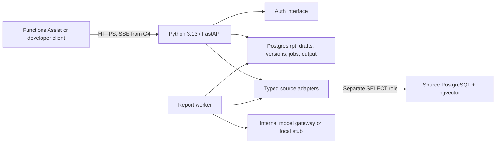
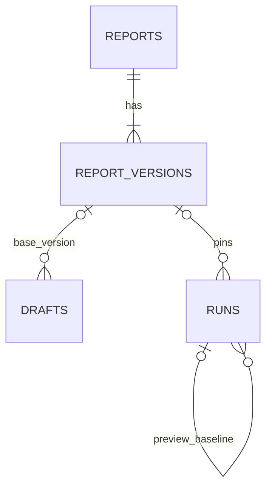

# Report agent architecture after R-001

[R-001](../reviews/R-001.md) approved the foundation and [R-002](../reviews/R-002.md) approved the G2 evidence slice. The product supports declarative fiscal periods, multiple sources per section and reviewed evidence-bound themes. [The tagged G0 plan](https://github.com/alexwday/aegis-report-agent/blob/review-001/docs/collab/plans/PLAN.md) records the original options.

## Processes and data



The codebase runs separate API and worker processes. Short queue claims set a three-minute lease. Source I/O and model calls run after the claim transaction. Expired leases can be reclaimed. The final update checks the unexpired attempt token. Versioned source schema fixtures initialize only the local database. Deployment uses a distinct migration credential. The native local runner provisions and removes a private Postgres socket cluster and uses independent read/write roles.



Each private row is scoped by the caller's verified subject-derived owner key or by an authorized parent. In G1 the [migration](../../../db/migrations/001_report_slice.sql) holds the necessary state. Report versions store JSON section specs with stable IDs. Preview jobs store a copy of the draft revision, selected scope and optional same-period saved baseline run. Preview outputs expire after a configurable period. The save transaction checks revision/head, appends a version and advances the draft base. A client idempotency key makes generation submission safe to retry with the same payload. G2 diffs list resolved periods on both sides and identify moved rows, changed cells and claim text. G3 can add versioned personal templates and export formats. G4 adds conversations/turns just in time, and G6 adds schedules and publication records.

## One declarative section

```json
{
  "id": "efficiency",
  "title": "Efficiency ratio trend",
  "bank": "SYN1-CA",
  "sources": [{"source": "benchmarking", "metric": "Efficiency Ratio", "segment": "Enterprise"}],
  "time": {"preset": {"kind": "same_quarter_years", "count": 4}, "compare": "prior_year"},
  "instruction": "Highlight a cited value and show the change from the prior year.",
  "output_format": "table_with_note"
}
```

The patch shape is `{revision, op, section}`, with add and replace validated against the current draft. Sections compile deterministically to retrieve, optional calculate, optional draft, deterministic numeric check and format. The API exposes compiled stages for inspection. Extract and LLM-based checking are deferred behind future capability flags. Each section has a bank and up to four source selections. It resolves at most 12 fiscal periods and 24 source/period requests. Trailing quarters, same-quarter-across-years and ordered sequences compile to offsets relative to the run quarter. Existing explicit offsets remain supported. Comparisons can name the previous quarter or previous fiscal year. Before authoritative peer calendar mappings exist, comparisons use source vendor fiscal labels and show the alignment basis.

The engine uses exact decimals. It preserves raw QoQ/YoY and labels the change basis. BPS=Yes means percentage-point actuals and basis-point changes. Normal known-basis rows use percent change, with zero and negative denominators treated as unavailable for relative growth. US Capital Markets ratio rows with unconfirmed BPS semantics retain an unknown basis. Prefer KPI metadata for units, then the row Units field. Mark the origin or display unit unknown. Display mapped currencies as unconfirmed. Calculate multi-year comparisons from like-for-like Actual observations. A derived KPI citation includes dataset, snapshot, bank, metric, segment and fiscal period. KPI notes remain deterministic and can feature a selected observation. Themes draft full cited sentences using earnings classification topics and matching passages from the selected sources. The validator checks that the approved text and topic appear for every cited ID. Malformed or unsupported output falls back to cited quotes. The engine escapes HTML and stores only used citations and report text. HTML and JSON come first, PDF next. G3 can broaden data-backed section formats and template options.

## Sources and readiness

- The bank catalog uses distinct instrument identifiers and unions aliases across periods, including NULL alias rows. Legacy calls match ticker and verify the numeric institution ID. Blank flags and stale flags are ordinary cases.
- Benchmarking selection uses named projections and treats absent shares or records, holes with NULL Actual, and duplicate observations distinctly. Aggregates have a separate future scope. Negative denominators, unknown units or change basis, and incompatible identity/units/currency do not produce comparisons.
- The earnings adapter probes legacy and unified independently. Legacy selection ranks Corrected ahead of Raw and chooses the greatest numeric version, keeping all blocks and ordered speaker/group positions. Unified calls order by page number. A cross-generation conflict remains an explicit unknown state. Parse event and version IDs from the right suffix of both generations’ verified filenames, compare the legacy value against its named columns and preserve the winning edition.
- G2 enables the unified slides pair and legacy RTS with bounded lexical search and configurable optional cosine distance. The supplement, event and Pillar 3 adapters report a typed unavailable state. Unverified twins remain outside published results.
- Readiness is ready, incomplete, absent or unknown, as assessed at the required tuple and selector. Availability flags only prioritize probes. Cheap markers are scoped counts, maximum update timestamps and distinct snapshot files for benchmarking, and per-file/per-event metadata inventories for calls. G2 applies the approved file/hash/chunk-count and load-timestamp rules to additional enabled sources.
- Two matching ready observations separated by the quiet interval gate automatic generation, for required scopes only. A changed marker, absent rows or a failed probe restarts the interval. Manual runs and previews use current evidence and report unknown, recently changed or stable per scope. A first observation provides unknown stability. Use a consistent read-only snapshot from probe through retrieval. G6 evaluates a separate correction window, publication rules and policies. A marker may miss a same-metadata correction. Revisit the trade-off at that gate using source evidence.
- Source adapters return opaque citations instead of internal paths. Authorized document resolution is a later integration. Public fixtures capture observed shapes and source quirks with fabricated data. The [catalog addendum](../../sources/PACK_v1.1_corrections.md) supplements the briefing. The v3 fixture mirrors the completed catalog in R-002 page 3.

## API, authentication and UI

See the [generated OpenAPI](../../../api/openapi.json) for G6. The paths cover template and bank catalogs, source probes, draft revisions and stage inspection, save and saved versions, runs, previews, formats and evidence. Ownership uses the single `get_current_user()` interface, authenticated subject only, with an explicitly local fixed provider and a configured upstream GET bearer exchange. Resource lookups return 404 outside the caller's scope. Save and revision conflicts return 409. Production auth accepts a bounded, safe upstream detail and fails closed on timeout or service outage. A deployment must provide an active-owner checker before saved report generation. The assistant and the reporting flow share a configurable internal chat/embedding provider interface with per-call credentials. A deterministic stub powers local and integration tests.

G4 persists conversation-scoped turns with POST-to-create, authenticated GET SSE using `Last-Event-ID`, and JSON result fallback. Events show queueing, start, tool progress, proposal, preview, final message, terminal state and proposal acceptance. Model tools resolve scope, inspect coverage, retrieve limited evidence, read the draft, propose a typed patch, request a preview and explain a diff. Apply, save and schedule remain explicit caller actions. G5 should evaluate the real gateway against the synthetic request corpus and rerun lexical and real-vector source evaluations on approved sources.

G5 delivers a thin loopback console and the written Functions Assist integration handoff. The console exercises templates, draft section edits, previews, chat, reconnect, citations, schedules, and exports through the existing API. Real-provider quality and latency remain with the reviewer. [UI specification](../../integration/functions-assist-ui.md), [API guide](../../integration/api-guide.md)

## Safety and operations

Pin resource ownership and enforce it at drafts, versions, outputs, citations and cross-resource baseline links. Hold source read credentials separately with a fixed search path, query timeouts and bound parameters. Render escaped content. Treat user instructions and disclosure text as untrusted, and keep access tokens, employee IDs, storage paths, rows and prompt text out of operational logs. Use the internal model gateway only, with bounded requests and response schemas. Set retention in deployment and obtain formal policy approval before production. Measure readiness delay, query failures, queue throughput, missing evidence and model cost without logging raw inputs.

Integration tests use a disposable local fixture and exercise role grants, mixed schema and nullable values, duplicate keys, edition order and overlap, changed markers, ownership and the complete authoring loop. A scripted HTTP demo runs the real API and worker. CI checks the generated contract against the checked-in artifact.

## G3 lifecycle and evaluation

R-003 supplied read-only findings from the real source tables. Call openings need substance ranking before the gateway. The 23-label crosswalk feeds weighted lexical matching over slide and RTS headings and chunk text. Search terms can be supplied independently. Optional configured embeddings contribute distance. The G3 evaluation scripts share the live adapter and claim paths and emit local-only excerpts and locators. The reviewer will return judged results in R-004. [PostgreSQL ranking documentation](https://www.postgresql.org/docs/15/textsearch-controls.html)

A section has a default one-step mode and an optional staged mode. A selected section preview returns typed traces for retrieve, calculate, draft, check and format where applicable. Staged mode can finish after retrieve for inspection. Numeric comparisons prefer the vendor QoQ or YoY value at standard offsets with known basis. Other values are labeled as calculated from rounded actuals.

Report catalog metadata is owner-scoped and separate from immutable versions. Archived reports can be restored. A clone copies an exact version. Historical drafts guard saves against the head at draft creation. System templates are shared and read-only. Personal templates snapshot an owned saved version. Saved reports expose PDF generated offline from JSON blocks, with escaped text and internal links to numbered source footnotes. [ReportLab paragraph links](https://docs.reportlab.com/reportlab/userguide/ch6_paragraphs/)

Schedule definitions are owner-scoped, revisioned and pin a saved version and quarter. Explicit enqueue uses the existing automatic path. Pausing or changing the definition invalidates earlier queued revisions. G6 advances target quarters automatically and publishes immutable generations with a per-period pointer. [Operations](../../integration/operations.md#automatic-scheduling)

## Later gates

| Gate | Tasks | Engineering days | Exit evidence |
|---|---|---:|---|
| G1 Slice | T-006–T-008, T-017–T-019 | 4–6 | Corrected source fixtures, separated runtime roles, two source adapters, cited next-quarter generation and scripted diff demo. |
| G2 Evidence | T-009–T-010, T-020–T-025 | 5–8 | Exact source catalog, immediate previews, fiscal presets, multi-source themes, slides/RTS, detailed diffs, and automatic-path demo. |
| G3 Reports | T-011–T-012, T-026–T-031 | 6–10 | Ranked retrieval and reviewer harnesses, staged previews, report and template lifecycle, cited PDF, and schedule definitions. |
| G4 Chat | T-013, T-032–T-037 | 4–6 | Document relevance, multi-bank comparisons, typed draft tools, durable turns and replayable SSE. |
| G5 Handoff | T-014, T-038–T-042 | 4–6 | Developer console and written UI/SSE contract for Functions Assist. |
| G6 Scheduling | T-015, T-043–T-047 | 5–8 | Toronto default timezone, zero extra maturity lag, 14-day correction window, complete required inputs by default, opt-in provisional publication, retries and concurrency controls. |
| G7 Hardening | T-016 | 4–7 | Approved retention and authorization wiring, load/cost results, deployment, Compose option and security review. |

See [questions](../QUESTIONS.md), [decisions](../DECISIONS.md) and the [G7 review list](G7-review.md). Main risks are exact catalog gaps, ambiguous numerical comparisons, late or missed changes, unsupported generation claims and sensitive content in release artifacts.
