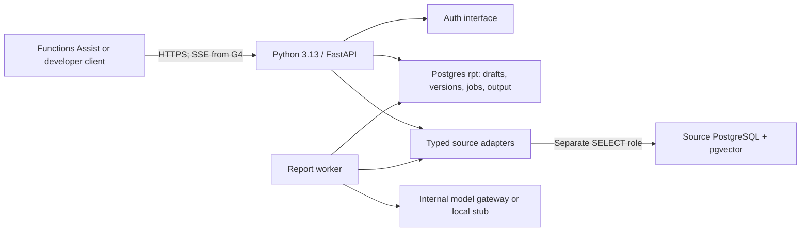
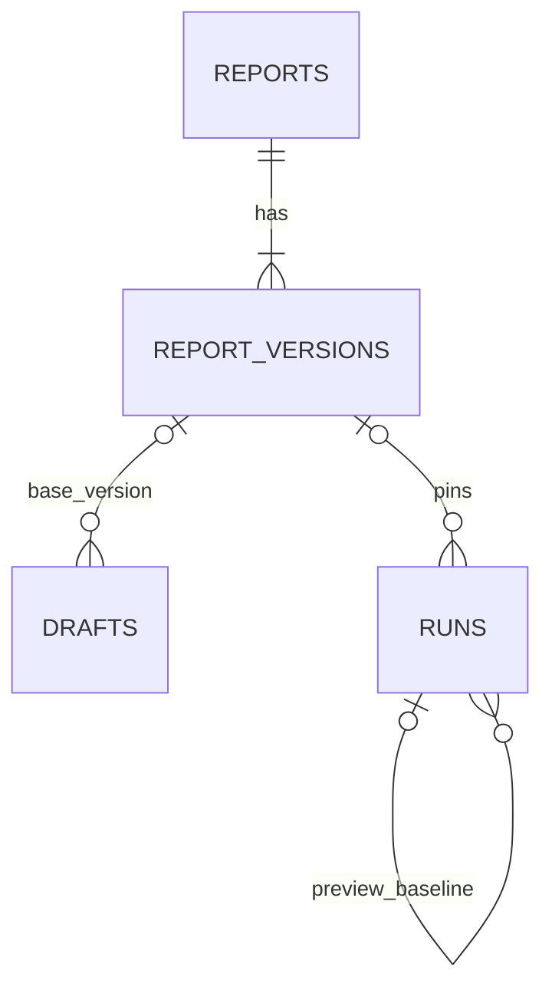

# Report agent architecture after R-001

[R-001](../reviews/R-001.md) approves the design with changes. G1 delivers the shortest report-authoring loop from template to a cited report for a later quarter. [The tagged G0 plan](https://github.com/alexwday/aegis-report-agent/blob/review-001/docs/collab/plans/PLAN.md) records the original options. This plan governs current implementation and later scope.

## Processes and data



The codebase runs separate API and worker processes. G1 queue claims use transaction-scoped row locks and an atomic update. Crash recovery releases the lock and rolls back the incomplete attempt. Versioned source schema fixtures initialize only the local database. Deployment uses a distinct migration credential. The native local runner provisions and removes a private Postgres socket cluster and uses independent read/write roles.



Each private row is scoped by the caller's verified subject-derived owner key or by an authorized parent. In G1 the [migration](../../../db/migrations/001_report_slice.sql) holds the necessary state. Report versions store JSON section specs with stable IDs. Preview jobs store a copy of the draft revision, selected scope and optional same-period saved baseline run. Preview outputs expire after a configurable period. The save transaction checks revision/head, appends a version and advances the draft base. A client idempotency key makes generation submission safe to retry with the same payload. G3 can add versioned personal templates, richer diffs and export formats. G4 adds conversations/turns just in time, and G6 adds schedules and publication records.

## One declarative section

```json
{
  "id": "efficiency",
  "title": "Efficiency ratio",
  "bank": "SYN1-CA",
  "sources": [{"source": "benchmarking", "metric": "Efficiency Ratio", "segment": "Enterprise"}],
  "time": {"offsets": [0], "compare_offset": -1, "basis": "vendor_fiscal_label"},
  "instruction": "Highlight a cited value and show the change from the prior quarter.",
  "output_format": "table_with_note"
}
```

The patch shape is `{revision, op, section}`, with add and replace validated against the current draft. Sections compile deterministically to retrieve, optional calculate, optional draft, deterministic numeric check and format. The API exposes compiled stages for inspection. Extract and LLM-based checking are deferred behind future capability flags. The G1 authoring slice accepts one benchmarking selection and bank per section, with bounded quarter offsets. The fiscal period rolls forward relative to the run's target. Before authoritative peer calendar mappings exist, comparisons use source vendor fiscal labels and show the alignment basis.

The engine uses exact decimals. It preserves raw QoQ/YoY and labels the change basis. BPS=Yes means percentage-point actuals and basis-point changes. Normal known-basis rows use percent change, with zero and negative denominators treated as unavailable for relative growth. US Capital Markets ratio rows with unconfirmed BPS semantics retain an unknown basis. Use KPI metadata for units. Display mapped currencies as unconfirmed. Calculate multi-year comparisons from like-for-like Actual observations. A derived KPI citation includes dataset, snapshot, bank, metric, segment and fiscal period. The model is restricted to selecting an available evidence ID. The engine binds every narrative number and table cell to a stored citation. HTML and JSON come first, PDF next. G3 can broaden data-backed section formats and template options.

## Sources and readiness

- The bank catalog uses distinct instrument identifiers and unions aliases across periods, including NULL alias rows. Legacy calls match ticker and verify the numeric institution ID. Blank flags and stale flags are ordinary cases.
- Benchmarking selection uses named projections and treats absent shares or records, holes with NULL Actual, and duplicate observations distinctly. Aggregates have a separate future scope. Negative denominators, unknown units or change basis, and incompatible identity/units/currency do not produce comparisons.
- The earnings adapter probes legacy and unified independently. Legacy selection ranks Corrected ahead of Raw and chooses the greatest numeric version, keeping all blocks and ordered speaker/group positions. Unified calls order by page number. A cross-generation conflict remains an explicit unknown state. When a unified filename matches the documented legacy event pattern, compare the ID for diagnostics. Full vendor identity guidance is Q-016.
- Slides, supplements, events, Pillar 3 and RTS expose typed unavailable adapters in G1. G2 enables supported source adapters incrementally. Unverified event, Pillar 3 and RTS twins require further evidence before use.
- Readiness is ready, incomplete, absent or unknown, as assessed at the required tuple and selector. Availability flags only prioritize probes. Cheap markers are scoped counts, maximum update timestamps and distinct snapshot files for benchmarking, and per-file/per-event metadata inventories for calls. G2 applies the approved file/hash/chunk-count and load-timestamp rules to additional enabled sources.
- Two matching ready observations separated by the quiet interval gate generation. A changed marker, absent rows or a failed probe restarts the interval. Use a consistent read-only snapshot from probe through retrieval. G6 evaluates a separate correction window, publication rules and policies. A marker may miss a same-metadata correction. Revisit the trade-off at that gate using source evidence.
- Source adapters return opaque citations instead of internal paths. Authorized document resolution is a later integration. Public fixtures capture observed shapes and source quirks with fabricated data. The [catalog addendum](../../sources/PACK_v1.1_corrections.md) supplements the briefing. Remaining exact column positions and index definitions are in Q-015.

## API, authentication and UI

See the [generated OpenAPI](../../../api/openapi.json) for G1. The paths cover template and bank catalogs, source probes, draft revisions and stage inspection, save and saved versions, runs, previews, formats and evidence. Ownership uses the single `get_current_user()` interface, authenticated subject only, with an explicitly local fixed provider and a configured upstream GET bearer exchange. Resource lookups return 404 outside the caller's scope. Save and revision conflicts return 409. Production auth accepts a bounded, safe upstream detail and fails closed on timeout or service outage. A deployment must provide an active-owner checker before saved report generation. The assistant and the reporting flow share a configurable internal chat/embedding provider interface with per-call credentials. A deterministic stub powers local and integration tests.

G4 adds durable turns with POST-to-create, authenticated GET SSE using `Last-Event-ID`, and a plain turn-result GET fallback. Candidate events cover accepted, message delta, clarification, tool progress, patch proposed, preview queued and terminal state. Model tools resolve scope, inspect coverage, retrieve limited evidence, read the draft, propose a typed patch and request a preview. Apply, save and schedule remain explicit caller actions.

G5 is a thin developer console and written UI spec for Functions Assist. A separate team is already designing the demo interface. The developer console should exercise every API endpoint and SSE event, including reconnect and failures. The written UI spec covers template selection, ordered section editing, conditions for preview and save, diff and citations, report generation state, access errors and controls.

## Safety and operations

Pin resource ownership and enforce it at drafts, versions, outputs, citations and cross-resource baseline links. Hold source read credentials separately with a fixed search path, query timeouts and bound parameters. Render escaped content. Treat user instructions and disclosure text as untrusted, and keep access tokens, employee IDs, storage paths, rows and prompt text out of operational logs. Use the internal model gateway only, with bounded requests and response schemas. Set retention in deployment and obtain formal policy approval before production. Measure readiness delay, query failures, queue throughput, missing evidence and model cost without logging raw inputs.

Integration tests use a disposable local fixture and exercise role grants, mixed schema and nullable values, duplicate keys, edition order and overlap, changed markers, ownership and the complete authoring loop. A scripted HTTP demo runs the real API and worker. CI checks the generated contract against the checked-in artifact.

## Later gates

| Gate | Tasks | Engineering days | Exit evidence |
|---|---|---:|---|
| G1 Slice | T-006–T-008, T-017–T-019 | 4–6 | Corrected source fixtures, separated runtime roles, two source adapters, cited next-quarter generation and scripted diff demo. |
| G2 Evidence | T-009–T-010 | 5–8 | Remaining source adapters, verified anchors, marker and relevance tests, extraction decisions informed by retrieval quality. |
| G3 Reports | T-011–T-012 | 6–10 | Broader typed stages and time scopes, richer comparisons, personal/system template lifecycle, PDF after HTML/JSON. Revisit shared extraction after usage evidence. |
| G4 Chat | T-013 | 4–6 | Typed draft tools, persisted/replayable SSE, turn-result fallback and abuse limits. |
| G5 Handoff | T-014 | 4–6 | Developer console and written UI/SSE contract for Functions Assist. |
| G6 Scheduling | T-015 | 5–8 | Toronto default timezone, zero extra maturity lag, 14-day correction window, complete required inputs by default, opt-in provisional publication, retries and concurrency controls. |
| G7 Hardening | T-016 | 4–7 | Approved retention and authorization wiring, load/cost results, deployment and security review. |

See [questions](../QUESTIONS.md) and [decisions](../DECISIONS.md). Main risks are exact catalog gaps, ambiguous numerical comparisons, late or missed changes, unsupported generation claims and sensitive content in release artifacts.
