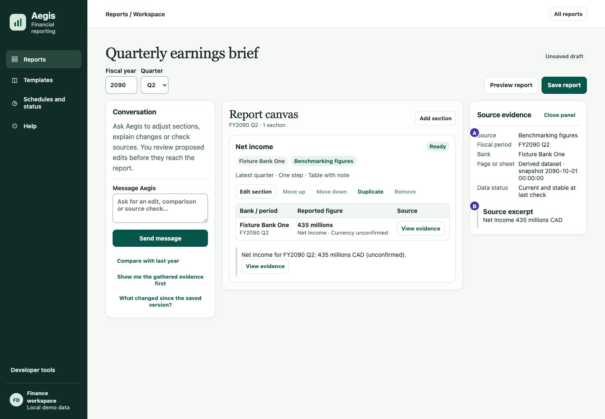
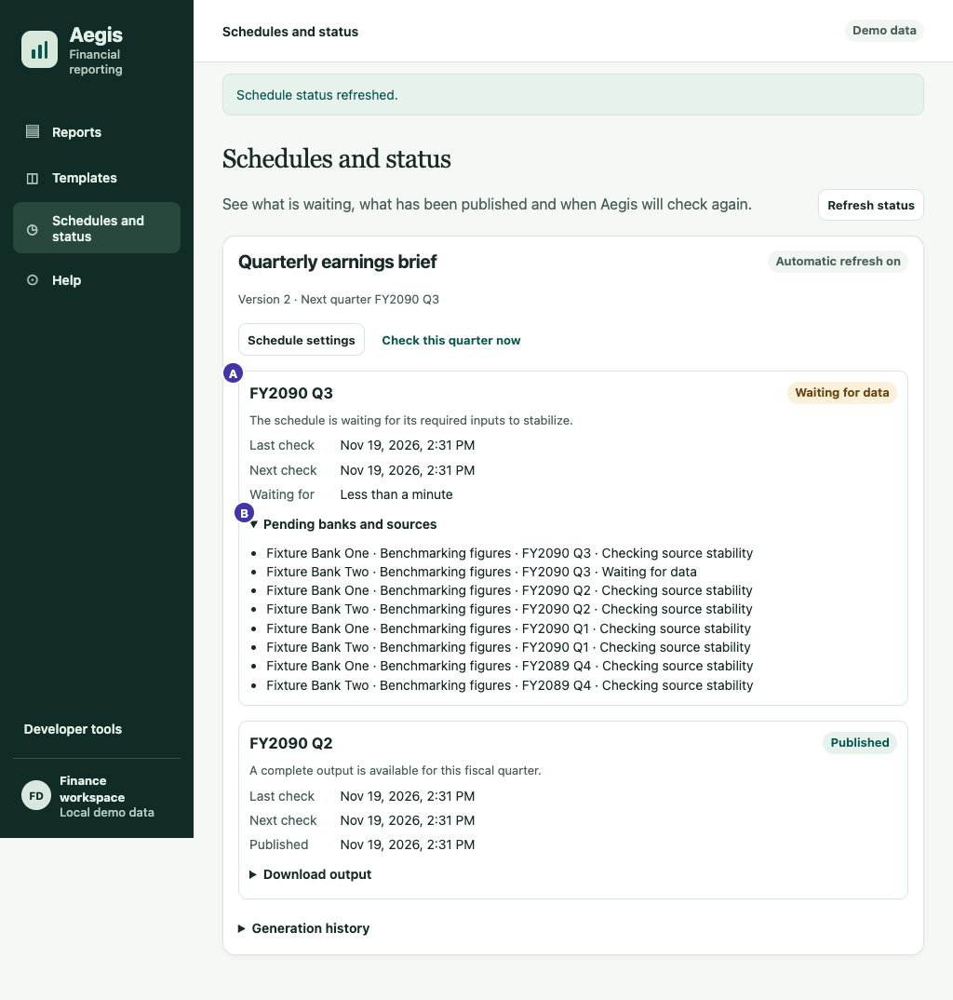

# Screen specification and captures

Desktop captures are 1440 × 1000 and tablet captures are 1024 × 900 before full-page expansion. Purple letters are screenshot annotations. They are added by the headless generator and disappear in the app. See the table for the areas each letter identifies. [Regenerate captures](demo.md#regenerate-and-test)

## Reports and templates

| Screen | Layout and annotations | Desktop | Tablet |
|---|---|---|---|
| Reports | A. Description and starting bank. B. Template cards with sections. C. Recent reports or an empty state. Use the primary action to open an unsaved workspace. | [Reports](screenshots/desktop-reports.png) | [Reports](screenshots/tablet-reports.png) |
| Recent reports populated | Show saved version, schedule state and pending banks next to Open and More. | [Recent](screenshots/desktop-reports-populated.png) | [Recent](screenshots/tablet-reports-populated.png) |
| Templates | A. System templates. B. Personal template area. Show description and section preview before choosing the starting bank. | [Templates](screenshots/desktop-templates.png) | [Templates](screenshots/tablet-templates.png) |
| Template start | A. Name, bank and Create draft in a focused dialog. The selected template remains visible underneath. | [Start](screenshots/desktop-template-start.png) | [Start](screenshots/tablet-template-start.png) |

## Workspace and contextual panels

| Screen | Layout and annotations | Desktop | Tablet |
|---|---|---|---|
| Unsaved draft | A. Conversation and suggestions. B. Canvas with section settings and status. C. Fiscal period, preview and save. | [Draft](screenshots/desktop-workspace-draft.png) | [Draft](screenshots/tablet-workspace-draft.png) |
| Report preview | A. Source-backed number with currency and unit. B. Evidence action opens a contextual drawer. | [Preview](screenshots/desktop-workspace-preview.png) | [Preview](screenshots/tablet-workspace-preview.png) |
| Proposal | A. Changes in plain language with Accept, Reject and Edit. B. Matching highlight on the canvas. | [Proposal](screenshots/desktop-chat-proposal.png) | [Proposal](screenshots/tablet-chat-proposal.png) |
| Chat-built report | A. Trend rendered from the figure table. B. Applied proposal remains readable in the conversation. | [Chat report](screenshots/desktop-chat-report.png) | [Chat report](screenshots/tablet-chat-report.png) |
| Reconnecting | A. Connection notice and reconnect control. Existing draft and conversation stay visible. | [Reconnect](screenshots/desktop-chat-reconnect.png) | [Reconnect](screenshots/tablet-chat-reconnect.png) |
| Confirm removal | A. Verb and danger treatment in a modal; the secondary action cancels. | [Confirmation](screenshots/desktop-destructive-confirmation.png) | [Confirmation](screenshots/tablet-destructive-confirmation.png) |
| Section settings | A. Bank scope. B. Title and editor forms. Source controls adapt to the selected source. | [Settings](screenshots/desktop-section-settings.png) | [Settings](screenshots/tablet-section-settings.png) |
| Gathered result | A. Evidence-only notice. B. Retrieved figures or passages in the section. | [Gathered](screenshots/desktop-gathered.png) | [Gathered](screenshots/tablet-gathered.png) |
| Saved vs preview | A. Change summary and paired values. B. Trend and cited rows on the same canvas. Expand peer comparisons by period. | [Changes](screenshots/desktop-comparison.png) | [Changes](screenshots/tablet-comparison.png) |
| Evidence | A. Source, fiscal period, bank, location and stability. B. Bounded excerpt. | [Evidence](screenshots/desktop-evidence.png) | [Evidence](screenshots/tablet-evidence.png) |
| Versions | A. Version, date, save note and Open as new draft. | [Versions](screenshots/desktop-versions.png) | [Versions](screenshots/tablet-versions.png) |
| Version changes | Expand What changed to compare report settings with the previous saved version. | [History](screenshots/desktop-version-changes.png) | [History](screenshots/tablet-version-changes.png) |

## Schedule and help

| Screen | Layout and annotations | Desktop | Tablet |
|---|---|---|---|
| Schedule settings | A. Enable switch, pinned version, first fiscal target and provisional wait policy. | [Schedule setup](screenshots/desktop-schedule-settings.png) | [Schedule setup](screenshots/tablet-schedule-settings.png) |
| Timeline | A. Fiscal-quarter status and last and next checks. B. Expand missing scopes or an available output. | [Timeline](screenshots/desktop-schedules.png) | [Timeline](screenshots/tablet-schedules.png) |
| Provisional output | A. Text-labelled provisional publication and format menu. Earlier complete output remains available. | [Provisional](screenshots/desktop-provisional.png) | [Provisional](screenshots/tablet-provisional.png) |
| Help | A. Task-oriented help. B. Source check. Developer tools below the cards. | [Help](screenshots/desktop-help.png) | [Help](screenshots/tablet-help.png) |

## Feedback states

| State | Presentation | Desktop | Tablet |
|---|---|---|---|
| Empty | Start or create options remain above the report list. The empty card gives the next step. | [Empty](screenshots/desktop-empty.png) | [Empty](screenshots/tablet-empty.png) |
| Loading | Render a named status in context and disable duplicate preview requests. | [Loading](screenshots/desktop-loading.png) | [Loading](screenshots/tablet-loading.png) |
| Partially sourced | Preserve available figures. Expand Source availability for missing rows and sources. | [Partial](screenshots/desktop-partial.png) | [Partial](screenshots/tablet-partial.png) |
| Source gives no matching evidence | A. The source responded with no matching evidence. Source availability provides the corresponding scope. | [No match](screenshots/desktop-no-match.png) | [No match](screenshots/tablet-no-match.png) |
| Edit conflict | Explain the draft changed and allow reload. | [Conflict](screenshots/desktop-conflict.png) | [Conflict](screenshots/tablet-conflict.png) |
| Expired | Offer reload to re-establish the session. | [Expired](screenshots/desktop-expired.png) | [Expired](screenshots/tablet-expired.png) |
| Scope limit | Name the limit in an alert and keep the draft visible. | [Limit](screenshots/desktop-limit.png) | [Limit](screenshots/tablet-limit.png) |
| Service error | Explain temporary failure and leave the attempted action available. | [Error](screenshots/desktop-error.png) | [Error](screenshots/tablet-error.png) |

